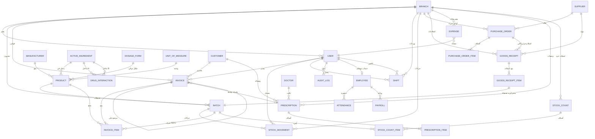

# مخطط قاعدة البيانات (ERD)

قاعدة البيانات موصوفة بـ Prisma في `prisma/schema.prisma` — 30+ نموذجاً. تعمل حالياً على SQLite وتُرحَّل إلى PostgreSQL بتغيير `provider` فقط.

## المخطط العام (Mermaid)



## الجداول الرئيسية والحقول

### 1) المؤسسة والمصادقة

| الجدول | الحقول المهمة | ملاحظات |
| --- | --- | --- |
| `Branch` | code, name, nameEn, address, phone, isActive, isDefault | فروع متعددة، فرع رئيسي واحد |
| `User` | username (فريد), passwordHash (bcrypt), fullName, role, pin, branchId, isActive, lastLoginAt | الأدوار: ADMIN / PHARMACIST / CASHIER / ACCOUNTANT / INVENTORY_MANAGER |
| `AuditLog` | userId, userName, action, entity, entityId, details | سجل كل عملية حساسة |

### 2) الكتالوج

| الجدول | الحقول المهمة |
| --- | --- |
| `Product` | barcode (فريد), tradeName, tradeNameEn, scientificName, activeIngredientId, dosageFormId, concentration, packSize, manufacturerId, originCountry, category (RX/OTC/MEDICAL_SUPPLY/COSMETIC/FOOD), purchasePrice, sellPrice, wholesalePrice, taxRate, minStock, reorderPoint, shelfLocation, requiresPrescription |
| `Batch` | productId, branchId, batchNo, expiryDate, quantity, costPrice, shelfLocation — أساس FEFO |
| `Manufacturer` / `ActiveIngredient` / `DosageForm` / `UnitOfMeasure` | بيانات أساسية (name + nameEn) |
| `DrugInteraction` | ingredientAId, ingredientBId, severity (MINOR/MODERATE/MAJOR), description |

### 3) حركات المخزون

| الجدول | الحقول المهمة |
| --- | --- |
| `StockMovement` | productId, batchId, branchId, type (RECEIVE/SALE/SALE_REFUND/TRANSFER_OUT/TRANSFER_IN/ADJUSTMENT/STOCK_COUNT/ISSUE), quantity (موجب دخول / سالب خروج), refType, refId, userId |
| `StockCount` / `StockCountItem` | جرد فعلي: systemQty, countedQty, variance — التسوية تُنشئ حركة STOCK_COUNT |

### 4) المبيعات

| الجدول | الحقول المهمة |
| --- | --- |
| `Customer` | code (فريد), name, phone, type (NORMAL/VIP/INSURANCE), insuranceProvider/Number, allergies (فواصل), chronicDiseases, medicalHistory, loyaltyPoints, creditBalance |
| `Invoice` | no (فريد INV-xxxxx), type (SALE/RETURN), status (COMPLETED/HELD/REFUNDED/PARTIALLY_REFUNDED/CANCELLED), subtotal, itemDiscount, invoiceDiscount, tax, total, paid, changeDue, paymentMethod (CASH/VISA/WALLET/CREDIT/INSURANCE), originalInvoiceId (للمرتجع), prescriptionId, eInvoiceUuid, loyaltyPointsEarned/Redeemed |
| `InvoiceItem` | invoiceId, productId, batchId, name (snapshot), qty, unitPrice, discount, taxRate, taxAmount, total, costPrice (لحساب الأرباح), refundedQty |

معادلات الفاتورة (متسقة بين الخادم والـ Seed):

```
itemNet     = unitPrice × qty − itemDiscount
itemTax     = itemNet × taxRate ÷ 100
subtotal    = Σ unitPrice × qty
tax         = Σ itemTax
total       = subtotal − itemDiscount − invoiceDiscount(يشمل الكوبون والنقاط) + tax
نقاط مكتسبة = floor(total ÷ loyaltyEarnRate)   (افتراضياً 50 ج.م/نقطة)
قيمة النقطة = loyaltyRedeemRate                (افتراضياً 0.25 ج.م)
```

### 5) المشتريات

| الجدول | الحقول المهمة |
| --- | --- |
| `Supplier` | code, name, contactPerson, phone, paymentTerms, balance |
| `PurchaseOrder` | no (PO-xxxx), status (DRAFT/SENT/PARTIALLY_RECEIVED/RECEIVED/CANCELLED), expectedAt |
| `PurchaseOrderItem` | productId, qty, unitCost, receivedQty |
| `GoodsReceipt` | no (GRN-xxxx), purchaseOrderId, subtotal — يرفع رصيد المورد |
| `GoodsReceiptItem` | productId, batchNo, expiryDate, qty, unitCost — ينشئ/يزيد `Batch` ويسجل حركة RECEIVE |

### 6) الصيدلة الإكلينيكية

| الجدول | الحقول المهمة |
| --- | --- |
| `Doctor` | name, specialty, clinic, phone |
| `Prescription` | no (RX-xxxx), status (PENDING/PARTIAL/DISPENSED/CANCELLED), source (MANUAL/IMAGE/OCR), invoiceId |
| `PrescriptionItem` | productId, productName, dosage, qty, dispensedQty |

### 7) المالية والموارد البشرية

| الجدول | الحقول المهمة |
| --- | --- |
| `Shift` | userId, branchId, openingBalance, closingBalance, expectedBalance, variance, status, openedAt, closedAt |
| `Expense` | type (EXPENSE/INCOME), category, amount, branchId |
| `Employee` / `Attendance` / `Payroll` | HR مبسط: رواتب، حضور (PRESENT/LATE/ABSENT/LEAVE)، رواتب شهرية (baseSalary/bonuses/deductions/netPaid) |

### 8) النظام

| الجدول | الحقول المهمة |
| --- | --- |
| `Settings` | صف واحد `main`: الملف التعريفي، الفواتير والضرائب، POS، المخزون والتنبيهات، الإشعارات، النسخ الاحتياطي، المظهر واللغة، مفاتيح التكاملات |
| `SettingSnapshot` | نسخة JSON كاملة قبل كل تعديل — للتراجع (Rollback) |
| `Notification` | type (LOW_STOCK/EXPIRY/PENDING_RX/SYSTEM/BACKUP), severity, isRead |
| `ServiceItem` / `Coupon` | خدمات نقطة البيع وكوبونات الخصم |

## سياسات مهمة

1. **FEFO**: `allocateFefo()` تختار التشغيلات الأقرب انتهاءً أولاً وتستبعد المنتهي، داخل معاملة `$transaction` ذرية.
2. **الحذف المنطقي**: المنتجات/العملاء/الفروع المرتبطة بفواتير تُعطَّل (`isActive=false`) بدل الحذف حفاظاً على السجل المحاسبي.
3. **الترقيم التلقائي**: `nextNumber()` تزيد عدادات `Settings` داخل نفس المعاملة (INV-/PO-/GRN-/RX-).
4. **التداخل الحساس**: فحص `interactions/check` يطابق المواد الفعالة لأصناف السلة مع جدول التداخلات، ومطابقة حساسية العميل (اسم عربي أو علمي).
