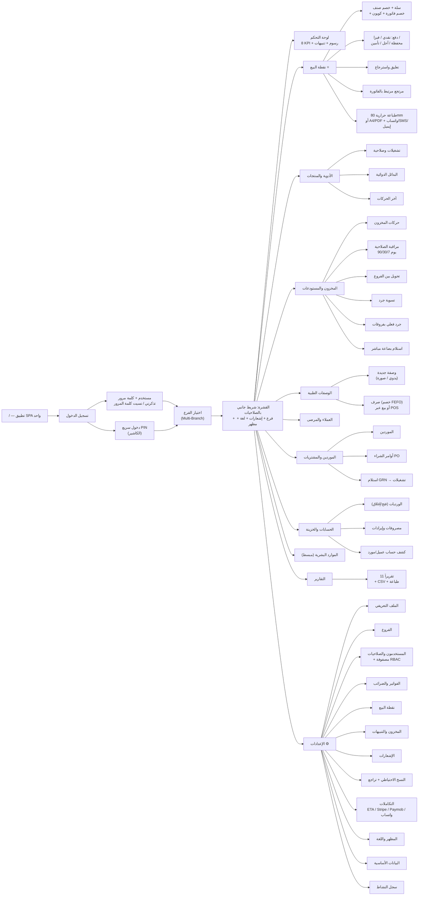
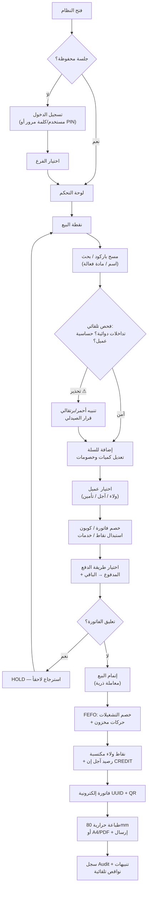
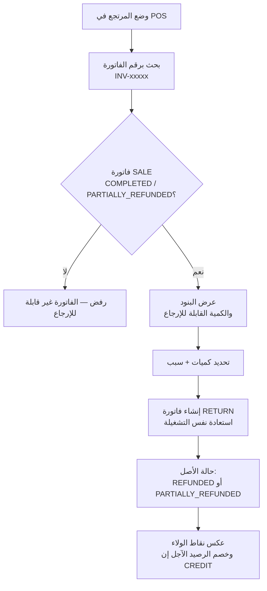

# خريطة النظام (Sitemap) وتدفق المستخدم (User Flow)

## 1) خريطة النظام

## 2) مصفوفة الوصول حسب الدور (RBAC)

| الشاشة | مدير | صيدلي | كاشير | محاسب | مسؤول مخزون |
| --- | :-: | :-: | :-: | :-: | :-: |
| لوحة التحكم | ✓ | ✓ | ✓ | ✓ | ✓ |
| نقطة البيع | ✓ | ✓ | ✓ | — | — |
| الأدوية والمنتجات | ✓ | ✓ | عرض | — | ✓ |
| المخزون | ✓ | ✓ | — | — | ✓ |
| الوصفات | ✓ | ✓ | ✓ | — | — |
| العملاء | ✓ | ✓ | ✓ | ✓ | — |
| الموردين والمشتريات | ✓ | ✓ | — | ✓ | ✓ |
| الخزينة | ✓ | ✓ | ✓ | ✓ | — |
| HR | ✓ | — | — | ✓ | — |
| التقارير | ✓ | ✓ | — | ✓ | ✓ |
| الإعدادات | ✓ | — | — | — | — |

الصلاحيات مطبقة على مستوى الخادم (`requireAuth(req, roles)`) وعلى مستوى الواجهة (`canAccess`).

## 3) تدفق المستخدم — دورة بيع كاملة

## 4) تدفق مرتجع مرتبط بالفاتورة

## 5) تدفق المشتريات والاستلام

## 6) مسارات سريعة (اختصارات)

- **الكاشير**: دخول PIN → POS مباشرة → بيع → طباعة. (الشاشات المتاحة: الرئيسية، POS، الأدوية، الوصفات، العملاء)
- **مسؤول المخزون**: نواقص من لوحة التحكم → استلام/تحويل/جرد → أمر شراء للنواقص.
- **المحاسب**: إغلاق وردية → مصروفات → كشوف حسابات → تقارير الضريبة والأرباح.
- **المدير**: كل شيء + الإعدادات (12 تبويب) + سجل النشاط + التراجع عن الإعدادات.
